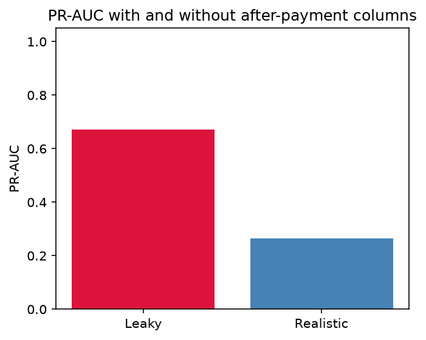
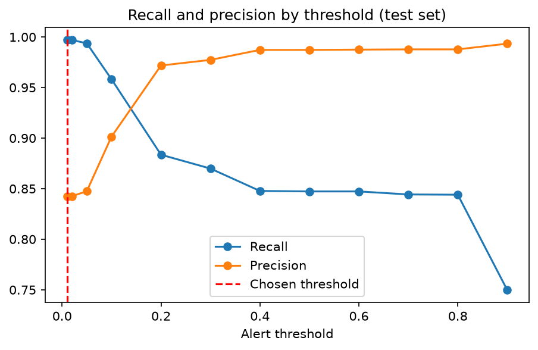
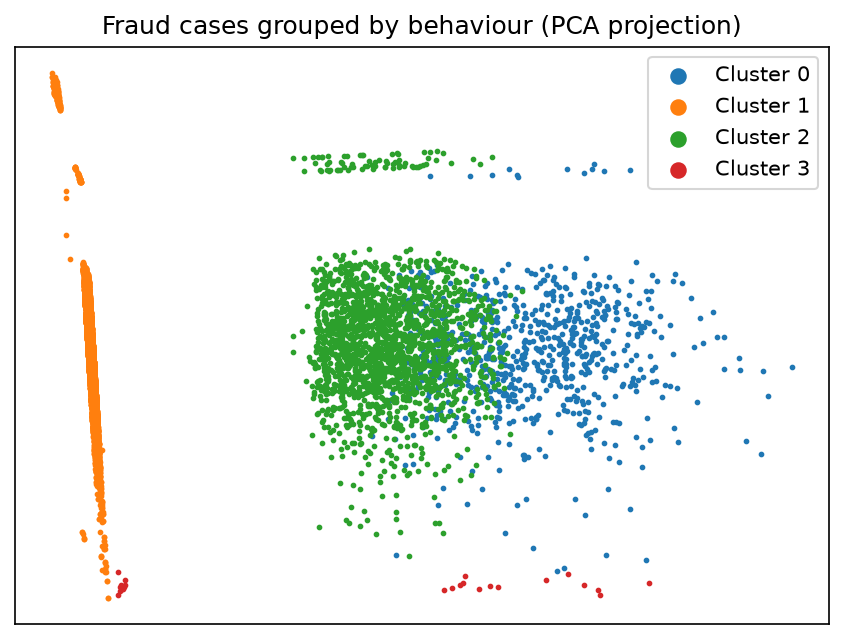
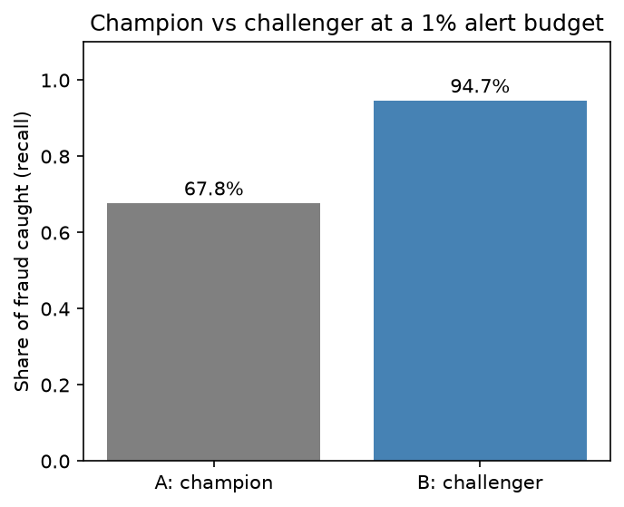
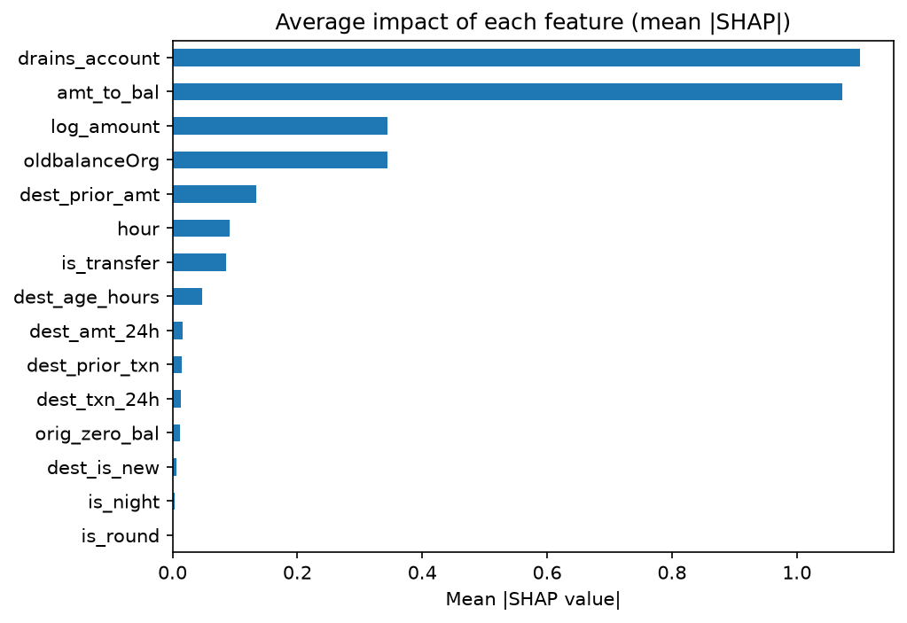
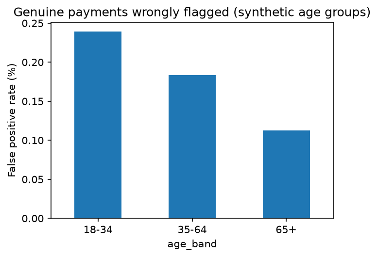

# ScamShield: Catching Payment Fraud with Machine Learning
*Chanakya Shah · Portfolio project using synthetic data (PaySim)*

---

## Summary
Fraud investigators can only review a small number of payments each day, so they need to know
which ones to look at first. I built a model that ranks payments by fraud risk and explains every
alert in plain English. On unseen data it caught **99.7% of fraud** while flagging only
**4,757 payments** out of 416,297, and **84 in every 100 alerts were genuine fraud**. In a simulated
side-by-side trial, it caught **27 percentage points more fraud** than a simpler model with
**73% fewer false alarms** at the same investigator workload.

---

## The problem
- Fraud causes financial loss and real harm to customers.
- Fraud is rare (about 3 in 1,000 transfers and cash-outs), so a model that always says
  "not fraud" would look over 99% accurate while catching nothing. I measured success by
  **how much fraud is caught** and **how many alerts investigators must review**, not by accuracy.

---

## Key findings

### 1. Checking the data first prevented a misleading result
Some columns recorded account balances *after* each payment, in a way that gave away which payments
were fraud. A quick model using them more than doubled its score (0.27 → 0.67), but a real bank
would never have that information at the moment a payment is made. I removed them and used only
information available **before** a payment completes.

### 2. The model is far more precise than a simple rule
Almost all fraud in this data **empties the victim's account**. But a rule that flags every
account-emptying payment would raise **186,801 alerts**, and only **2 in 100** would be fraud.
The model catches more fraud (**99.7%**) with **4,757 alerts** (97% fewer), because it learns
*which* account-emptying payments are suspicious, for example large ones sent to brand-new accounts.

### 3. There are distinct kinds of fraud, and the model's weak spot is known
Grouping fraud cases by behaviour revealed four patterns:

| Pattern | Share of fraud | Caught (test) | Suggested action |
|---|---|---|---|
| Transfer to a brand-new account | 67% | 99.96% | Hold large account-emptying payments to new payees and confirm with the customer |
| Cash-out through an established, quiet account | 23% | 99.3% | Flag dormant accounts that suddenly receive a full balance |
| Cash-out through a busy, recently active account | 9% | 97.5% | Review receiving accounts with rapid incoming activity (likely "mule" accounts) |
| Fraud that does not empty the account | 0.3% | n/a | Low priority; rare |

9 of the model's 12 misses were **cash-outs through established, quiet accounts** from senders
with smaller balances. They looked like normal activity, which is the clearest area for improvement.

### 4. A simulated trial confirms the model should replace the simpler one

| | Current model | New model |
|---|---|---|
| Fraud caught | 67.8% | **94.7%** |
| Genuine payments wrongly flagged | 707 | **194** |

The improvement held across 50 different random splits (+25 to +31 points). Before the trial I
calculated that about **4 days** of live traffic would be enough to detect a meaningful improvement.

---

## Every alert comes with reasons
Each flagged payment shows its top three reasons, for example:
*"Payment empties the account · Payment as a share of balance · Receiver is brand new."*
The two strongest signals (emptying the account, and the payment's share of the balance) make up
about two-thirds of the model's decisions.

---

## Fairness check
The data has no customer demographics, so I created a **synthetic age group** to test the auditing
method. Wrongly flagged genuine payments were rare for everyone (under 0.25%), and fraud protection
was equal across groups. However, younger customers were wrongly flagged about **2.1 times more
often** than over-65s, a statistically significant difference that arose indirectly through spending
behaviour. Because the attribute is synthetic, this demonstrates **how** such bias would be
detected, not a real-world finding.

---

## Recommendation
1. **Adopt the new model** to rank payments for review, with a person reviewing every alert.
2. **Start in "shadow mode"**: let it score payments silently alongside the current system first,
   then run a live trial randomised by customer.
3. **Watch dormant receiving accounts**: the pattern behind most of the model's misses.

## Risks and limitations
- **Synthetic data:** PaySim's fraud is simpler than real fraud, so real-world performance would be lower.
- **Money figures:** PaySim amounts are unrealistically large, so savings are not quoted in pounds.
- **Delayed labels:** in reality fraud is often confirmed weeks later.
- **Changing behaviour:** fraudsters adapt, so the model would need monitoring and regular retraining.

## Next steps
- Add sender behaviour-over-time features to catch fraud that looks like normal activity.
- Build monitoring that alerts when payment patterns drift.
- Validate on real (anonymised) bank data.